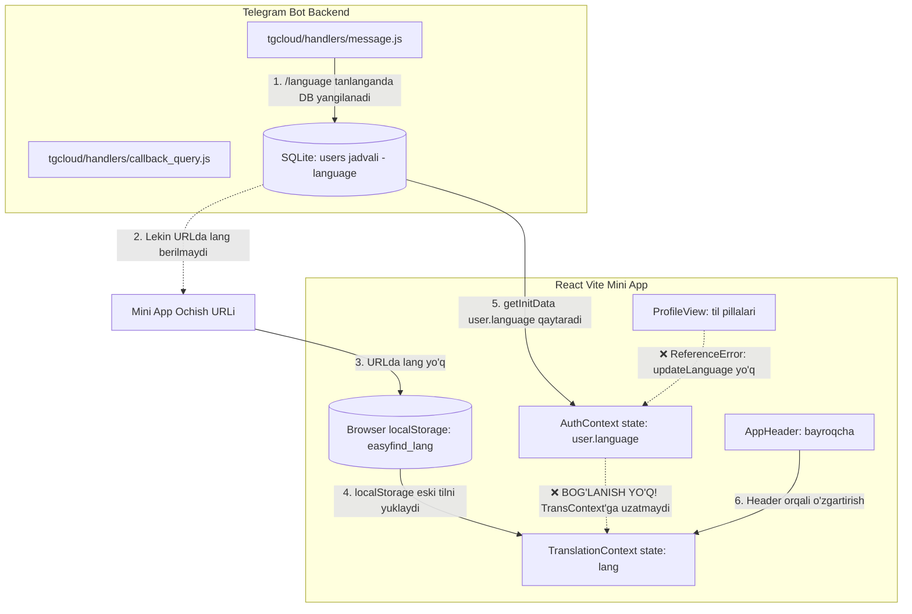

# EasyFindBot — Bot va WebApp Sinxronizatsiyasi Tahlili va Kamchiliklar Rejasi

> **Hujjat maqsadi:** Ushbu hujjat EasyFindBot loyihasidagi Telegram Bot (`tgcloud/`) va React Mini App (`src/`) o'rtasidagi ma'lumotlar almashinuvi, sinxronlik darajasi, xususan **tilni o'zgartirish jarayoni** ikkala tomonda qanday ishlashi yoki ishlamayotganini chuqur tahlil qilish, aniqlangan barcha arxitekturaviy va dasturiy muammolarni tizimlashtirish hamda ularni bartaraf etish bo'yicha batafsil bosqichma-bosqich rejani taqdim etadi.
>
> ⚠️ **Diqqat:** Foydalanuvchi ko'rsatmasiga muvofiq, kod bazasiga hech qanday o'zgartirish kiritilmadi, faqat audit o'tkazilib, natijalar ushbu `.md` faylga jamlandi.

---

## 1. Qisqa Xulosa (Executive Summary)

**Asosiy savolga qat'iy javob:** 
Hozirgi holatda Telegram Bot va WebApp o'rtasida **til sinxronizatsiyasi ISHLAMAYDI**. 

* **Botda til o'zgartirilsa:** WebApp'da til **O'ZGARMAYDI**. Foydalanuvchi botda rus yoki ingliz tilini tanlasa ham, WebApp brauzerdagi `localStorage` keshida qolib ketgan tilni (yoki sukut bo'yicha o'zbek tilini) ko'rsatishda davom etadi.
* **WebAppda til o'zgartirilsa:** 
  1. Profil sahifasida til tugmasi bosilganda kodda e'lon qilinmagan o'zgaruvchi sababli **`ReferenceError` (kritik runtime xatosi)** yuz beradi yoki ma'lumotlar bazasiga so'rov bormaydi.
  2. Bosh qismdagi (Header) bayroqcha orqali o'zgartirilganda esa `AuthContext`dagi tekshiruv xatosi tufayli so'rov yuborilmasligi mumkin; yuborilgan taqdirda ham Telegram Botning klaviaturasi yangilanmay eski tilda qolib ketadi.
* **Arxitekturaviy chalkashlik:** Loyiha ildizida (`/`) va `tgcloud/` katalogi ichida backend fayllarining ikkita nusxasi mavjud bo'lib, ildizdagi nusxalar eskirgan va yaroqsiz holga kelgan.

---

## 2. Ma'lumotlar Oqimi va Sinxronizatsiya Sxemasi

Quyidagi jadvalda foydalanuvchining tili va holati qayerda qanday saqlanishi ko'rsatilgan:



---

## 3. Aniqlangan Kritik Muammolar va Nuqsonlar (Root Causes)

### 🔴 1-Muammo: Botdan WebApp ochilish URL manzillarida `lang` parametri yo'qligi
* **Fayl:** `tgcloud/handlers/message.js` (`buildMainReplyKeyboard` funksiyasi, 15–40-qatorlar)
* **Muammo tavsifi:**
  Foydalanuvchi botda tilni o'zgartirganda `buildMainReplyKeyboard` funksiyasiga yangi tanlangan til (`lang`) argument sifatida uzatiladi. Funksiya ichida esa Mini App ochish havolalari quyidagicha tuzilgan:
  ```javascript
  userParams = `&uid=${uid}`;
  if (fn) userParams += `&first_name=${encodeURIComponent(fn)}`;
  ...
  web_app: { url: `${miniAppBaseUrl}?startapp=jobs${userParams}${vParam}` }
  ```
  Ko'rinib turibdiki, `userParams` ichiga `&lang=${lang}` parametri **qo'shilmagan**!
* **Oqibati:** Mini App ochilganda, URL parametrlarida foydalanuvchi qaysi tilni tanlagani haqida hech qanday signal bo'lmaydi.

---

### 🔴 2-Muammo: `TranslationProvider`ning faqat `localStorage`ga qotib qolganligi
* **Fayl:** `src/locales/index.jsx` (18–28-qatorlar)
* **Muammo tavsifi:**
  Mini App ishga tushganda uning boshlang'ich tili quyidagi mantiq asosida belgilanadi:
  ```javascript
  const [language, setLanguageState] = useState(() => {
    try {
      const stored = localStorage.getItem('easyfind_lang');
      if (stored && ['uz', 'ru', 'en'].includes(stored)) {
        return stored;
      }
    } catch (e) {}
    return initialLanguage; // 'uz'
  });
  ```
* **Oqibati:**
  1. `TranslationProvider` URLdagi `?lang=...` parametrini tekshirmaydi.
  2. `Telegram.WebApp.initDataUnsafe.user.language_code`ni tekshirmaydi.
  3. Agar foydalanuvchi birinchi marta kirgan bo'lsa `uz` bo'ladi, agar oldin kirib WebApp'da o'zbek tilida qolgan bo'lsa, botda rus tiliga o'tkazsa ham `localStorage`dagi `uz` qiymati qat'iy o'qiladi va WebApp rus tiliga o'tmaydi.

---

### 🔴 3-Muammo: Komponentlar ierarxiyasidagi xatolik (`src/main.jsx`)
* **Fayl:** `src/main.jsx` (18–24-qatorlar)
* **Kod holati:**
  ```jsx
  <ThemeProvider>
    <TranslationProvider>
      <AuthProvider>
        <App />
      </AuthProvider>
    </TranslationProvider>
  </ThemeProvider>
  ```
* **Muammo tavsifi:**
  `TranslationProvider` komponenti `AuthProvider`ning **ota (parent)** elementi qilib o'ralgan.
* **Oqibati:**
  `AuthProvider` serverdan (`api.getInitData()`) foydalanuvchining bazadagi tilini (`user.language`) tortib olsa ham, u o'zidan tepada turgan `TranslationProvider`ga ta'sir o'tkaza olmaydi va unga bu ma'lumotni yetkazish imkoni bo'lmaydi.

---

### 🔴 4-Muammo: `AuthContext` serverdan kelgan tilni `TranslationContext`ga sinxronlamasligi
* **Fayl:** `src/context/AuthContext.jsx` (61–121-qatorlar)
* **Muammo tavsifi:**
  `fetchSession` funksiyasida `api.getInitData()` chaqiriladi. Server bazadan foydalanuvchi ma'lumotlarini (`dbUser`) muvaffaqiyatli qaytaradi (masalan, `user.language = 'ru'`). 
  Lekin `AuthContext.jsx` ichida:
  1. `useTranslation()` chaqirilmagan.
  2. `setLanguage` yoki `setLang` umuman ishlatilmagan.
  3. Olingan `data.user` faqat `AuthContext`ning ichki `user` obyektiga saqlanadi, butun dastur interfeysi esa `TranslationContext`dagi eski tilda qolib ketadi.
* **Oqibati:** Serverdan to'g'ri til kelayotgan bo'lsa ham, WebApp interfeysi o'zgarmaydi.

---

### 🔴 5-Muammo: `ProfileView.jsx`dagi `ReferenceError` (Kritik dasturiy xato)
* **Fayl:** `src/modules/profile/ProfileView.jsx` (18-qator va 364-qator)
* **Kod holati:**
  * 18-qator:
    ```javascript
    const { user, role, resume, switchRole, loading } = useAuth();
    ```
    *(Diqqat qiling: `updateLanguage` destrukturizatsiya qilinmagan!)*
  * 364-qator:
    ```javascript
    onClick={() => {
      setLang(item.code);
      if (updateLanguage) updateLanguage(item.code);
    }}
    ```
* **Muammo tavsifi:**
  Foydalanuvchi Profil bo'limiga kirib, til tugmalaridan birini (`UZ`, `RU`, `EN`) bosgan paytda `updateLanguage` o'zgaruvchisi topilmagani sababli brauzerda **`ReferenceError: updateLanguage is not defined`** xatosi ro'y beradi (yoki silent fail bo'lib, serverga hech narsa yuborilmaydi).
* **Oqibati:** Foydalanuvchi profildan tilni o'zgartirganda, bu o'zgarish serverdagi `users` jadvaliga **SAQLANMAYDI**!

---

### 🔴 6-Muammo: `AuthContext.jsx`dagi `updateLanguage` shartidagi mantiqiy blokirovka
* **Fayl:** `src/context/AuthContext.jsx` (139–147-qatorlar)
* **Kod holati:**
  ```javascript
  const updateLanguage = useCallback(async (newLang) => {
    if (!user || user.language === newLang) return;
    try {
      setUser((prev) => ({ ...prev, language: newLang }));
      await api.updateUser({ language: newLang });
    } catch (err) { ... }
  }, [user]);
  ```
* **Muammo tavsifi:**
  Mini App ochilganda `user.language` dastlab Telegramning o'zidan (`u.language_code` masalan `ru`) olinadi. Lekin `TranslationProvider` o'zbekcha (`uz`) ochilgan bo'lsa, foydalanuvchi tilni rus tiliga o'tkazish uchun `ru`ni tanlasa:
  `user.language === 'ru'` va `newLang === 'ru'` bo'lib qoladi. Natijada funksiya hech narsa qilmay `return` qilib yuboradi va `api.updateUser` serverga chaqirilmay qoladi.

---

### 🔴 7-Muammo: WebAppda til o'zgarganda Bot klaviaturasining yangilanmasligi
* **Fayl:** `tgcloud/endpoints/updateUser.js`
* **Muammo tavsifi:**
  Agar WebApp'dan `api.updateUser({ language: 'ru' })` muvaffaqiyatli chaqirilib, SQLite bazasidagi `users.language` yangilansa ham, Telegram Bot API xususiyatiga ko'ra chatdagi `ReplyKeyboardMarkup` faqat bot foydalanuvchiga xabar jo'natgandagina yangilanishi mumkin.
  `updateUser.js` endpointi esa faqat JSON javob qaytaradi, bot orqali chatga xabar yoki klaviatura yangilanishini push qilmaydi.
* **Oqibati:** Foydalanuvchi WebApp'ni yopib bot chatiga qaytsa, chatdagi tugmalar (masalan, `🔍 Ish qidirish`, `🌐 Tilni o'zgartirish`) eski tilda qoladi. Faqat biror xabar yozgandagina bot yangi klaviaturani chiqaradi.

---

### 🔴 8-Muammo: Kanal postlari va bildirishnomalarda hudud va ish turi tarjima qilinmasligi
* **Fayl:** `tgcloud/lib/bot/channel.js` (26–27-qatorlar) va `tgcloud/lib/bot/notifier.js` (105-qator)
* **Muammo tavsifi:**
  Vakansiya tasdiqlanib kanalga yoki obunachilarga yuborilganda:
  ```javascript
  `📍 <b>${escapeHtml(t(lang, 'channel.region'))}:</b> ${escapeHtml(vacancy.region)}\n` +
  `⏱️ <b>${escapeHtml(t(lang, 'channel.employment_type'))}:</b> ${escapeHtml(vacancy.employmentType)}\n`
  ```
  Hudud (`vacancy.region`) va ish turi (`vacancy.employmentType`) tarjima qilinmasdan, to'g'ridan-to'g'ri inglizcha slug holida chiqadi (masalan: `📍 Hudud: tashkent`, `⏱️ Ish turi: full_time`).
* **Oqibati:** Kanal postlarida va bot xabarlarida chala tarjima va inglizcha kalit so'zlar ko'rinadi.

---

### 🔴 9-Muammo: Loyiha ildizidagi va `tgcloud/` katalogidagi fayllar dublikatsiyasi (Drift)
* **Joylashuv:** 
  * Ildizda: `/endpoints/` (16 ta fayl), `/handlers/` (2 ta fayl), `/lib/`, `/schema.js`
  * `tgcloud` ichida: `/tgcloud/endpoints/` (16 ta fayl), `/tgcloud/handlers/` (2 ta fayl), `/tgcloud/lib/`, `/tgcloud/schema.js`
* **Muammo tavsifi:**
  `git diff` orqali solishtirilganda ma'lum bo'ldiki, ildizdagi fayllar eskirgan (masalan, `handlers/message.js` ildizda 11 KB, `tgcloud/` ichida esa 22 KB). `tgcloud push` buyrug'i faqat `tgcloud/` katalogini serverga yuklaydi.
* **Oqibati:** Agar dasturchi tasodifan ildizdagi faylni tahrirlasa, o'zgarishlar deploy bo'lmaydi va tizimda jiddiy chalkashlik yuzaga keladi.

---

### 🔴 10-Muammo: Deep Link havolalarida til konteksti yo'qligi
* **Fayl:** `tgcloud/lib/bot/channel.js` (36-qator) va `tgcloud/lib/bot/notifier.js` (80, 116-qatorlar)
* **Muammo tavsifi:**
  Kanal postlari ostidagi "Ariza topshirish" tugmasi:
  `https://t.me/<bot>/app?startapp=vac_<id>`
  Ish beruvchiga kelgan xabarnomadagi havola:
  `https://t.me/<bot>/app?startapp=my_vacs`
  Ushbu havolalarning hech birida til ma'lumoti uzatilmaydi.

---

## 4. Boshqa Funksional Sohalarning Sinxronlik Tahlili

| Soha / Funksiya | Bot holati | WebApp holati | Sinxronlik darajasi | Izoh |
| :--- | :--- | :--- | :--- | :--- |
| **Foydalanuvchi Autentifikatsiyasi** | `tgId` orqali avtomatik ro'yxatga oladi | `initData` / `uid` orqali taniydi | 🟢 **Sinxron (Yaxshi)** | Ikkala tomon ham `tgId`ga tayanadi |
| **Rol (Seeker / Employer)** | Klaviaturada har ikkala rolni ko'rsatadi | Profil va Headerda almashtiriladi (`switchRole`) | 🟡 **Qisman sinxron** | Bazada yangilanadi, lekin bot klaviaturasi o'zgarmaydi |
| **Admin huquqlari** | `users.role = 'admin'` yoki `superAdminTgId` | `getInitData.isAdmin` boolean orqali olinadi | 🟢 **Sinxron** | Adminlik to'g'ri uzatiladi |
| **Vakansiyalar moderatsiyasi** | Botda admin tasdiqlaydi / rad etadi | WebAppda faqat `approved` va `closed` ko'rinadi | 🟢 **Sinxron** | Statuslar to'g'ri boshqariladi |
| **Arizalar (Applications)** | Ish beruvchiga botda xabarnoma boradi | WebAppda ko'riladi va statusi yangilanadi | 🟢 **Sinxron** | Status o'zgarsa nomzodga botda xabar boradi |
| **Rezyumelar (Resumes)** | Faqat arizaga biriktirilganda ko'rinadi | Yaratish, tahrirlash va ko'rish to'liq WebAppda | 🟢 **Sinxron** | SQLite `resumes` orqali bog'langan |
| **Mavzu (Theme Dark/Light)** | Telegram mijoz sozlamasi | Telegram `themeChanged` hodisasini tinglaydi | 🟢 **Sinxron (Yuqori)** | `ThemeContext` juda to'g'ri yozilgan |
| **Til (Language UZ/RU/EN)** | Baza va bot klaviaturasida o'zgaradi | `localStorage`da qotib qoladi, sinxronlanmaydi | 🔴 **Sinxron EMAS (Kritik)** | Ikkala yo'nalishda ham uzilish mavjud |

---

## 5. Bosqichma-bosqich Tuzatish Rejasi (Action Plan)

Ushbu reja loyihani to'liq sinxron holatga keltirish uchun tavsiya etiladigan amaliy qadamlardir:

### 1-Bosqich: Arxitekturaviy tozalash va Dublikatlarni bartaraf etish
1. Ildizdagi eskirgan `/endpoints/`, `/handlers/`, `/lib/` kataloglari va `/schema.js` faylini tekshirib, xavfsiz tarzda o'chirish yoki arxivlash (barcha backend kodi faqat `tgcloud/` ichida yashashi shart).
2. `package.json` va build skriptlarini faqat `tgcloud/` papkasiga yo'naltirilganligini tasdiqlash.

### 2-Bosqich: Bot va Backend tomonida Til parametrlarini to'g'rilash
1. **`tgcloud/handlers/message.js` (`buildMainReplyKeyboard`)**:
   Mini App URL parametrlariga `&lang=${lang}` parametrini qo'shish:
   ```javascript
   userParams += `&lang=${lang}`;
   ```
2. **`tgcloud/lib/bot/channel.js` va `tgcloud/lib/bot/notifier.js`**:
   * Hudud va ish turini xom slug emas, tarjima lug'ati orqali chiqarish:
     `t(lang, 'regions.' + vacancy.region)` va `t(lang, 'employment_types.' + vacancy.employmentType)`.
3. **`tgcloud/endpoints/updateUser.js`**:
   * Foydalanuvchi WebApp orqali tilni o'zgartirganda, bot orqali unga til yangilanganligi haqida xabar va yangilangan `reply_markup` yuborish imkoniyatini kiritish (`api.sendMessage`).

### 3-Bosqich: Frontend Kontekst va Lokalizatsiya Iyerarxiyasini qayta qurish
1. **`src/locales/index.jsx` (`TranslationProvider`)**:
   * Boshlang'ich tilni aniqlash zanjirini quyidagi ierarxiyada qurish:
     1. URL parametridagi `?lang=...` (agar botdan kelgan bo'lsa, bu eng ustuvor).
     2. `Telegram.WebApp.initDataUnsafe.user.language_code`.
     3. `localStorage.getItem('easyfind_lang')`.
     4. Default fallback: `'uz'`.
   * Tashqi modullardan tilni sinxronlashtirish uchun ochiq metod taqdim etish.
2. **`src/context/AuthContext.jsx`**:
   * `fetchSession` ichida `api.getInitData()` javobidan `backendUser.language` kelganda, uni darhol `TranslationContext`ga uzatish (`setLang(backendUser.language)`).
   * `updateLanguage` funksiyasidagi xato `user.language === newLang` to'siq shartini to'g'rilash.
3. **`src/modules/profile/ProfileView.jsx`**:
   * 18-qatorda `useAuth()`dan `updateLanguage`ni destrukturizatsiya qilish:
     ```javascript
     const { user, role, resume, switchRole, updateLanguage, loading } = useAuth();
     ```
   * Bu orqali 364-qatordagi `ReferenceError`ni to'liq bartaraf etish.

### 4-Bosqich: Sinov va Verifikatsiya (Test Cases)
1. **Test 1 (Bot -> WebApp):**
   * Botda `/language` orqali "🇷🇺 Русский" tanlanadi.
   * Bot klaviaturasidan "🔍 Поиск вакансий" tugmasi bosiladi.
   * WebApp rus tilida ochilishi shart.
2. **Test 2 (WebApp -> Bot):**
   * WebApp ichida Profil bo'limiga kirib "🇬🇧 EN" tugmasi bosiladi.
   * WebApp ingliz tiliga o'tadi va serverga `updateUser` yuboriladi.
   * WebApp yopilganda Telegram chatida bot klaviaturasi ingliz tiliga ("🔍 Search Jobs") o'zgargan bo'lishi kerak.
3. **Test 3 (Kanal havolasi):**
   * Kanalga e'lon joylanadi, hudud va bandlik turi to'g'ri o'zbek/rus tilida chiqishi tekshiriladi.
   * E'lon ostidagi havola bosilganda to'g'ri vakansiya modali ochilishi tekshiriladi.

---

## 6. Xulosa

EasyFindBot loyihasining Telegram Serverless va React komponentlari poydevori mustahkam va zamonaviy qurilgan. Biroq yuqorida ko'rsatilgan 10 ta muammo, xususan **`TranslationProvider`ning izolyatsiya bo'lib qolgani**, **URL parametrida `lang` uzatilmasligi** va **`ProfileView.jsx`dagi `ReferenceError`** sababli til sinxronligi butunlay uzilib qolgan.

Yuqoridagi 4 bosqichli reja asosida tuzatishlar kiritilsa, bot va webapp o'rtasidagi til va boshqa holatlar to'liq va uzluksiz sinxronlikka erishadi.
